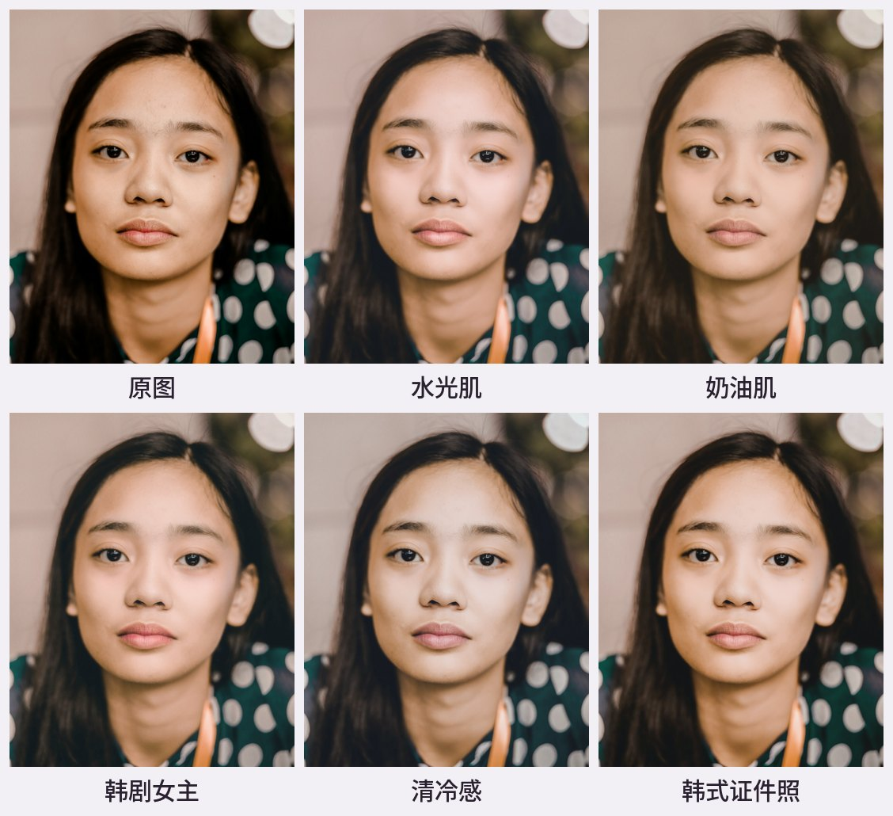
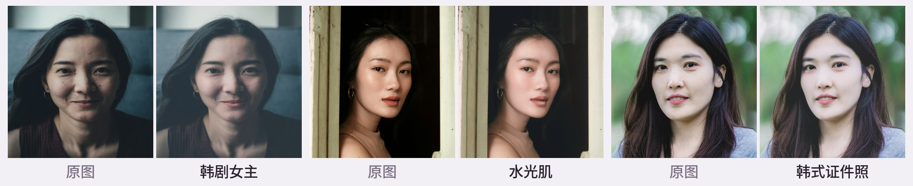

# SeoulGlow 韩系修图

上传一张自拍，选一个韩系风格，几秒钟修成水光肌、奶油肌、韩剧女主感……而且**还是你自己的脸**。

*Upload a selfie, pick a Korean look, get a natural K-beauty retouch that still looks like you. Built for Chinese users: Chinese UI, mobile-first, works with China-reachable AI services.*

> 🚧 项目在分阶段开发中，进度见下方「路线图」。

## 效果





以上全部是**本地精修模式的默认参数**，没有用 AI 大模型，也没有手动修改。

> 示例照片来自 [Unsplash](https://unsplash.com/license)（可免费使用和修改），摄影师：Peter John Manlapig、panitan punpuang、Minh Dang、Condor Wei。

## 能做什么

| 风格 | 效果 |
|------|------|
| 水光肌 | 清透发光的皮肤，额头、鼻梁、苹果肌高光，蜜桃水光唇 |
| 奶油肌 | 柔雾哑光，低对比的暖杏 / 奶茶色调 |
| 韩剧女主 | 柔焦光晕、暖粉色调、眼下腮红、卧蚕、草莓咬唇，带一点胶片颗粒 |
| 清冷感 | 冷白皮，低饱和的蓝灰色调，冷调玫瑰唇 |
| 韩式证件照 | 棚拍感：明亮均匀、干净精致、自然淡妆 |

每种风格都能再细调：**磨皮、美白、瘦脸、大眼、妆容、滤镜**，还能换 5 种口红色号。按住「看原图」随时对比。多人合照里的每张脸都会处理。

**两种模式**

- **本地精修（默认，免费）**：在你自己的服务器上运行，不调用任何外部服务，不会改变长相。
- **AI 写真（可选）**：接入图像大模型（阿里云百炼 / 火山引擎 / Google Gemini）生成更有氛围感的韩系写真，比如换成证件照纯色背景。没配置 API Key 时自动使用本地精修。

## 快速开始

需要 Python 3.10+。

```bash
pip install -r requirements.txt
python scripts/download_models.py     # 下载人脸模型（约 3.6 MB）
python -m seoulglow.web               # 打开 http://127.0.0.1:8000
```

想用手机访问电脑上的服务：`python -m seoulglow.web --host 0.0.0.0`，然后在同一个 Wi-Fi 下用手机打开 `http://电脑的IP:8000`。

> 国内网络下载不了模型时：在别处下载 `face_landmarker.task` 放进 `models/` 文件夹，或用 `--url` 指定镜像地址。

命令行批量修图：

```bash
python -m seoulglow photo.jpg -s kdrama          # 输出 photo_kdrama.jpg
python -m seoulglow photo.jpg --all              # 5 种风格各出一张
```

开启 AI 写真：复制 `.env.example` 为 `.env`，填入任意一家的 API Key。

## 它是怎么工作的

```
照片 ──► 人脸关键点（MediaPipe，478 个点）
          │
          ├─ 皮肤   自适应肤色模型 → 祛痘（中值修复）→ 磨皮（导向滤波 + 保留毛孔细节）
          │        → 美白去黄（Lab 空间）→ 水光高光 / 奶油雾面
          ├─ 妆容   渐变咬唇、水光唇、苹果肌腮红、卧蚕、亮眼、牙齿美白
          ├─ 脸型   瘦脸：一个由高斯 RBF 组成的平滑位移场（避免下颌线变波浪）；大眼：局部放大
          └─ 调色   每个风格编译成 3D LUT（33³）+ 柔光 + 胶片颗粒
```

几个关键设计：

- **克制，像真人**：参数是对照网上真实的韩式精修前后对比、在真人照片上调出来的。专业精修只把皮肤提亮几个色阶、稍微去黄、保留毛孔，而不是"变白"；所以美白在 Lab 空间只提亮约 5 个 L\*，并且脸、耳朵、脖子一起提亮，避免"面具脸"。
- **口红是"染"不是"涂"**：唇色跟着每个像素原本的明暗走（阴影里的上唇更暗、更不饱和），嘴角渐隐，这样不会像蜡笔画上去。
- **先修颜、后变形**：所有妆容用原始关键点画好，最后再统一做瘦脸大眼，妆容会跟着脸一起动，不会错位。
- **痘痘也是皮肤**：肤色模型会把痘痘当成"不是皮肤"排除掉，所以对肤色概率图做低分辨率形态学闭运算，把小洞补上。
- **快**：小区域效果（唇、眼、牙）只在局部框里计算；调色用 LUT（比逐像素计算快约 4.5 倍）；调节滑块时只传 1280px 预览图，保存时才处理高清图。

## 项目结构

```
seoulglow/
  face.py        人脸关键点检测 + 人脸坐标系
  masks.py       皮肤 / 唇 / 眼等软蒙版
  skin.py        祛痘、磨皮、美白、水光、雾面
  makeup.py      口红、腮红、卧蚕、亮眼、牙齿
  reshape.py     瘦脸、大眼
  color.py       韩系调色（参数化 + 3D LUT，可导出 .cube）
  presets.py     5 个韩风预设和口红色号
  engine.py      整条流水线
  ai/            AI 写真：百炼 / 火山 / Gemini + 中英文提示词 + AI 标识
  web/           Starlette 接口 + 手机网页（原生 JS，无需构建）
scripts/download_models.py
```

## 路线图

- [x] 第 1 部分：本地韩系美颜引擎（皮肤、妆容、脸型、调色、5 个风格）+ 命令行
- [x] 第 2 部分：AI 写真接口（三家大模型，无 Key 自动回退本地）
- [x] 第 3 部分：手机优先的中文网页
- [x] 第 4 部分：用真人照片调参（解决面具脸、口红发假、腮红过重），补充效果对比图
- [ ] 第 5 部分：自动化测试 + GitHub Actions + 完整文档
- [ ] 之后：本地换背景（人像分割）、部署指南

## 隐私

照片只在内存中处理，服务器不会保存。AI 写真会把照片发给你配置的大模型服务商，结果会带「AI生成」角标和元数据标识（参考《人工智能生成合成内容标识办法》）。

## License

MIT
